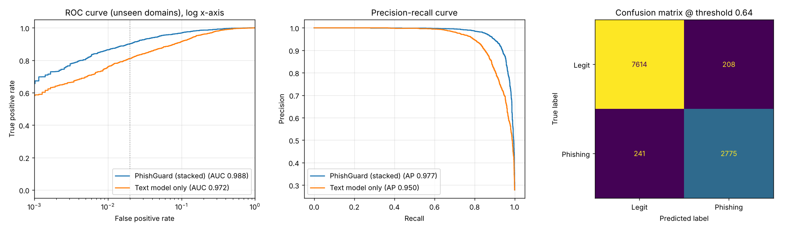

# PhishGuard: an explainable phishing URL classifier

PhishGuard decides whether a link is phishing **from the URL text alone**. It never visits
the site, so it is instant, works offline, and is safe to run on live phishing links. Every
verdict comes with human-readable reasons.

```
$ python -m phishguard.predict "http://paypal.com.account-verify.xyz/webscr/login.php"
PHISHING     100.0%  http://paypal.com.account-verify.xyz/webscr/login.php
    - Mentions 'paypal', but the real domain is account-verify.xyz
    - The hostname is unusually long (host_length=29, above 95% of legitimate URLs)
    - Many subdomains, a common trick to put a trusted name in front of the real domain (num_subdomains=2, ...)
    - Uses a top-level domain that is heavily abused for phishing
    - Contains words phishing pages use, like 'login', 'verify' or 'account' (4 found)
    - Points to a server script or executable (.php, .exe, .zip, ...)
    - Suspicious fragments: 'xyz', 'login', 'paypal', 'verify', 'account'
```

## Results

Measured on **10,838 URLs from 6,897 websites the model never saw during training**, using
the pure ML score (no allowlist):

| Metric | Held-out test | 5-fold grouped CV (mean ± std) |
|---|---|---|
| ROC-AUC | **0.988** | 0.986 ± 0.002 |
| Phishing caught at a 2% false-alarm rate | **90.2%** | 89.1% ± 1.3% |
| Accuracy (at the tuned threshold) | 95.9% | |
| Precision / recall | 93.0% / 92.0% | |

Red-team check (`scripts/red_team.txt`): all 12 phishing techniques are flagged (look-alike
subdomains, typosquats, raw IPs, punycode, the `@` trick, free hosting, Google Forms,
shorteners, compromised WordPress sites), and 8 of 10 legitimate URLs pass. The 2 that fail
are listed under Limitations.

Full report: [`reports/report.md`](reports/report.md) ·
plots: [`reports/evaluation.png`](reports/evaluation.png) ·
every mistake: [`reports/errors.csv`](reports/errors.csv)



**Ablation**, all on the same test set: this is the table to show in a presentation.

| Setup | ROC-AUC | Recall @ 2% FPR |
|---|---|---|
| Naive tutorial setup: raw URLs, random split | 0.9999 | 99.9% ← *fake* |
| Raw URLs, split by domain | 0.9986 | 99.5% ← *still fake (scheme leak)* |
| Char n-grams, normalised, split by domain | 0.9755 | 82.6% |
| Hand-crafted features only | 0.9541 | 68.1% |
| Text model (char + word) only | 0.9724 | 81.1% |
| **PhishGuard stacked model** | **0.9878** | **90.2%** |

## What makes this project different

Most phishing-classifier tutorials report 99%+ accuracy. That number is almost always an
artifact of the data, not a sign that the model understands phishing. This project measures
and removes each of those artifacts, and the [ablation table](reports/report.md) shows the
effect of every fix.

| Trap in the public datasets | What a naive model learns | Fix in PhishGuard |
|---|---|---|
| 94% of ISCX benign URLs are `http://`, and the faizann24 benign URLs have no scheme at all, while phishing is about half `https://` | "https or a scheme means phishing" | `normalize_url()` strips scheme and `www.` before any feature is computed (a unit test enforces this) |
| The ISCX benign set covers only about 310 websites, some with over 1,000 URLs each | Memorise those sites | Cap of 40 URLs per domain, plus 25k benign URLs from about 25k other sites |
| A random train/test split puts the same domain on both sides | Recognise the domain, not the attack | **Train/test split by registered domain**: every test site is one the model has never seen |
| Almost every benign URL has a long path | "Homepage means phishing" | 10k popular-site homepages added as benign |
| A threshold of 0.5 ignores the cost of false alarms | Too many false alarms, so users ignore the warnings | The threshold is chosen on validation domains for a **≤2% false-positive budget** |

It also found a gap that no test-set score shows. An early version scored 97% on its test
set yet flagged `github.com/login` and `en.wikipedia.org` as phishing, because the benign
data had almost no subdomains or login pages. The fix was more varied data plus a
reputation layer, the same approach browsers take (see below). `scripts/red_team.txt` holds
hand-written tricky URLs for exactly this kind of reality check.

## How it works

```
                        ┌────────────────────────────────────────────┐
  raw URL ─► normalise ─┤ Text model                                 │
  (strip scheme, www.)  │  TF-IDF char 3-5-grams + word tokens       ├─► text score ─┐
                        │  -> logistic regression                    │               │
                        └────────────────────────────────────────────┘               ▼
                        ┌────────────────────────────────────────────┐   ┌───────────────────────┐
  raw URL ─────────────►│ 30 hand-crafted security features          ├──►│ Meta model             │─► ML score
                        │  brand impersonation, typosquatting,        │   │ gradient-boosted trees │
                        │  IP host, punycode, abused TLD, shortener,  │   └───────────────────────┘
                        │  free hosting, entropy, '@' trick, ...      │               │
                        └────────────────────────────────────────────┘               ▼
                                                      reputation check (top-10k domains, but
                                                      not shorteners or user-content hosts)
                                                                                      ▼
                                                    verdict: safe / suspicious / phishing + reasons
```

* **Stacking rather than averaging.** The trees see the hand-crafted features *and* the
  text model's score, so they learn when a red flag (raw IP, typosquat) should override the
  text model. The text score used in training is produced **out-of-fold, grouped by
  domain**. Without that, the trees would see over-confident in-sample scores and learn to
  trust them blindly. On validation, stacking beat simple averaging by about 3.5 points of
  recall at 2% FPR.
* **Explanations** come from two places: the hand-crafted features (for example "longer
  than 95% of legitimate URLs") and the text model's coefficients (which fragments of this
  URL pushed the score up).
* **Reputation layer.** A URL on one of the 10,000 most popular registered domains is
  marked safe, *unless* the host is a shortener or a user-content platform (Google
  Docs/Forms, Firebase, 000webhost, GitHub Pages, ...). Phishers really do host pages there:
  `docs.google.com` is the single most common host in the PhishTank data. The reported
  metrics are for the pure ML model, without this layer, so they are not inflated by it.

## Quick start

```bash
pip install -r requirements.txt
./scripts/download_data.sh          # ~30 MB of public datasets into data/raw/
python -m phishguard.train          # ~10-15 min: trains, cross-validates, writes reports/
python -m phishguard.train --quick  # ~3 min: skips cross-validation and ablation

python -m phishguard.predict "http://paypa1.com/signin"
python -m phishguard.predict --file scripts/red_team.txt
python -m phishguard.predict --json "https://bit.ly/3xYzAbC"

uvicorn phishguard.api:app          # web page at http://127.0.0.1:8000, API docs at /docs
pytest                              # 20 tests
```

API example:

```bash
curl -s localhost:8000/predict -H 'Content-Type: application/json' \
     -d '{"url": "http://secure-appleid.apple.com.unlock-account.top/"}'
```

## Project layout

```
phishguard/
  urltools.py   URL parsing: registered domain, subdomain, TLD, IP detection, normalisation
  features.py   30 explainable lexical features (brands, typosquats, entropy, TLDs, ...)
  data.py       Loads, de-duplicates, de-biases and domain-splits the datasets
  model.py      Stacked text + feature model, explanations, reputation layer, save/load
  train.py      Threshold tuning, test evaluation, grouped CV, ablation, plots, report
  predict.py    Command-line classifier
  api.py        FastAPI service (+ static/index.html web page)
tests/          Unit tests for parsing, features, model and API
reports/        Generated: report.md, metrics.json, evaluation.png, feature_importance.png, errors.csv
scripts/        Data download script and a red-team URL list
```

## Data

| File | Source | Used as |
|---|---|---|
| `phishtank_online_valid.csv` | PhishTank verified-online dump (2020), 14.8k URLs | phishing |
| `benign_iscx.csv` | ISCX-URL2016 benign crawl, 35k URLs | benign |
| `faizann_urls.csv` | [faizann24](https://github.com/faizann24/Using-machine-learning-to-detect-malicious-URLs) "good" URLs, 345k URLs from 108k sites (a 25k sample is used) | benign |
| `top10k_domains.txt` | [Top 10k domains](https://github.com/zer0h/top-1000000-domains) | benign homepages + reputation list |

## Limitations (an honest list)

* **Known false positives** (both in `scripts/red_team.txt`):
  `my.smallcreditunion.org/online-banking/login` (a real login page on a small, unknown
  domain looks exactly like phishing from the URL alone), and
  `blog.janesmith.dev/posts/rust-async`. The benign training data is from 2016-17, before
  the `.dev` TLD existed and when modern blog-style paths were rare.
* **Permutation importance undercounts the hand-crafted features**, because they overlap
  with the text score (shuffling one leaves the others carrying the same signal). The
  ablation is the better evidence: they lift recall at 2% FPR from 81% to 90%.
* **URL-only.** A phishing page on a clean-looking, compromised domain
  (`small-bakery.com/wp-includes/x/`) is the hardest case. The next step would be page
  content (forms that post to other domains, brand logos on non-brand domains) or
  network/OSINT data (domain age from WHOIS, certificate transparency logs).
* **Dataset age.** The benign and phishing data come from different years (2016 and 2020),
  so some differences are about time, not maliciousness. Retraining on a fresh PhishTank or
  OpenPhish feed plus a current crawl would fix this.
* **Concept drift.** Phishers adapt. A real deployment would retrain regularly and monitor
  the false-positive rate on live traffic.
* **Adversarial robustness.** Someone who knows the features can craft a URL to evade
  them, which is why production systems layer several signals.
* The lightweight public-suffix handling in `urltools.py` covers common suffixes only. A
  full PSL library such as `tldextract` is more exact.

## Ideas for extending it

1. Add WHOIS domain age and certificate-transparency features as an optional online mode.
2. Train a character-level CNN or a small transformer on the raw URL and add it to the stack.
3. Build a browser extension that calls the API and colours the toolbar icon.
4. Run an adversarial evaluation: generate evasive variants of caught URLs and measure recall.
5. Calibrate the probabilities (`CalibratedClassifierCV`) and plot a reliability diagram.
