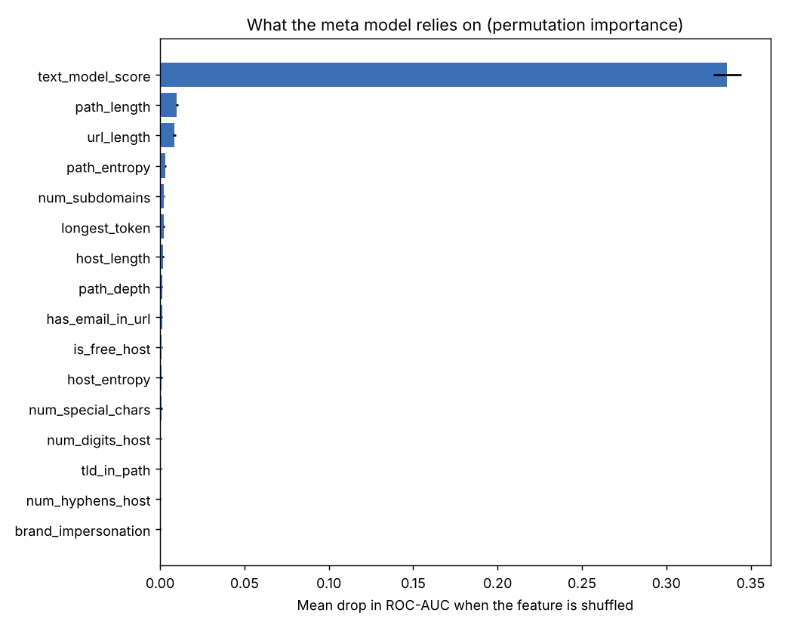

# PhishGuard evaluation report

Trained 2026-10-17 18:29 on 42,563 URLs; tested on 10,838 URLs from **6,897 domains never seen in training**. All scores are the pure ML model, without the reputation allowlist.

## Held-out test set

| Metric | Value |
|---|---|
| threshold | 0.6416 |
| accuracy | 0.9586 |
| precision | 0.9303 |
| recall | 0.9201 |
| f1 | 0.9252 |
| false positive rate | 0.0266 |
| roc auc | 0.9878 |
| pr auc | 0.9771 |
| recall at 2pct fpr | 0.9019 |

Confusion matrix: {'tn': 7614, 'fp': 208, 'fn': 241, 'tp': 2775}

Decision threshold 0.6416, chosen on validation domains for a false-positive budget of 2%.

## 5-fold domain-grouped cross-validation (threshold 0.5)

| Metric | Mean | Std |
|---|---|---|
| accuracy | 0.9534 | 0.0033 |
| precision | 0.8851 | 0.0093 |
| recall | 0.9215 | 0.0076 |
| f1 | 0.9029 | 0.0083 |
| false positive rate | 0.0368 | 0.0022 |
| roc auc | 0.9855 | 0.0015 |
| pr auc | 0.9685 | 0.0035 |
| recall at 2pct fpr | 0.8906 | 0.0126 |

## Ablation: why the evaluation design matters

| Setup | Accuracy | F1 | ROC-AUC | Recall @ 2% FPR |
|---|---|---|---|---|
| Naive: raw URLs, random split (leaky) | 0.9976 | 0.9948 | 0.9999 | 0.9992 |
| Raw URLs, domain split (still leaky: scheme) | 0.979 | 0.9634 | 0.9986 | 0.9947 |
| Char n-grams only, normalised, domain split | 0.9385 | 0.8858 | 0.9755 | 0.8263 |
| Hand-crafted features only, domain split | 0.8996 | 0.8269 | 0.9541 | 0.6814 |
| Text model (char + word) only, domain split | 0.933 | 0.8751 | 0.9724 | 0.811 |
| PhishGuard stacked model, domain split | 0.9586 | 0.9252 | 0.9878 | 0.9019 |

The first two rows are how most tutorials evaluate. They are inflated: the model memorises domains and the fact that benign URLs in these datasets rarely carry a scheme or https.

## Recall by impersonated brand (PhishTank label)

| Brand | Phishing URLs | Recall |
|---|---|---|
| Other | 2600 | 0.9277 |
| PayPal | 116 | 0.8707 |
| RuneScape | 38 | 1.0 |
| Facebook | 37 | 0.8919 |
| Microsoft | 36 | 0.9444 |
| Steam | 26 | 0.9231 |
| eBay, Inc. | 25 | 0.84 |
| Orange | 17 | 0.5882 |

